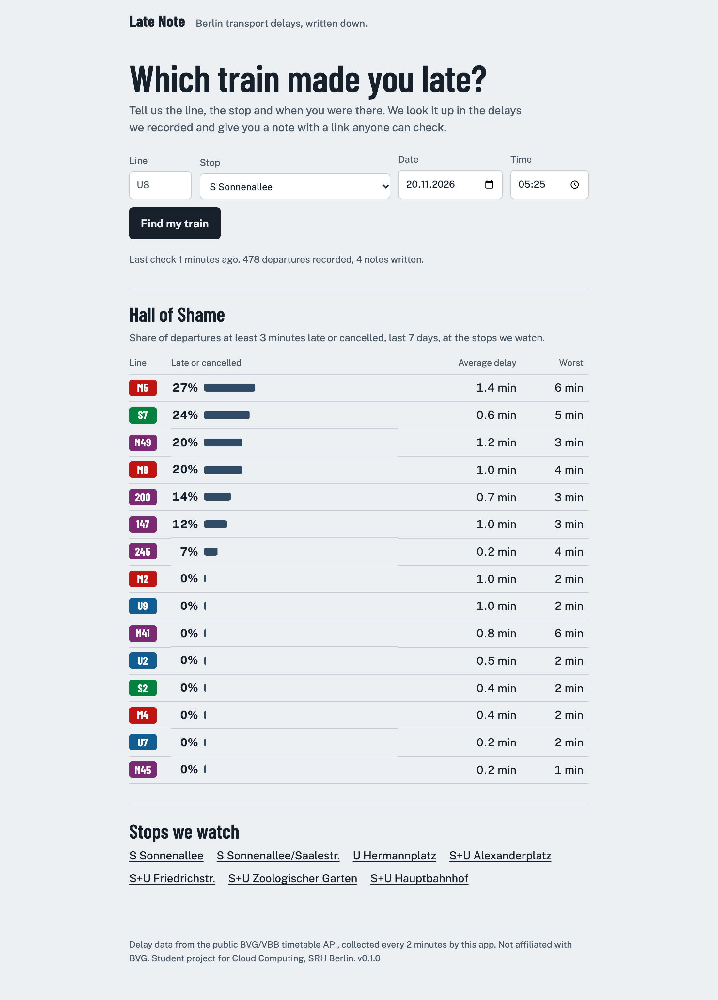
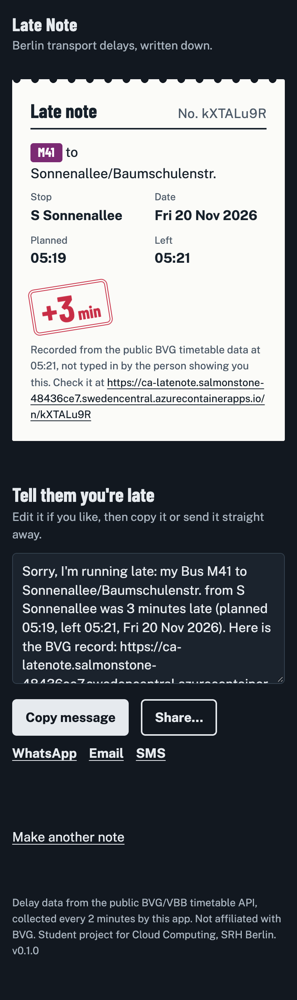

# BVG Late Note

[](https://github.com/AbdulMuhaiminKhan/bvg-late-note/actions/workflows/ci.yml)
[](https://ca-latenote.salmonstone-48436ce7.swedencentral.azurecontainerapps.io)
[](docs/cost.md)
[](LICENSE)

**Real Berlin transport delays, turned into a note you can show.**

"The U8 was 12 minutes late" is easy to say and hard to prove. BVG Late Note
records every departure and its delay at a set of Berlin stops, every 2 minutes,
from the public BVG timetable data. When you were late, you look up your train
and get a note with a link anyone can check.

**Live:** <https://ca-latenote.salmonstone-48436ce7.swedencentral.azurecontainerapps.io>

<table>
  <tr>
    <td width="63%" valign="top"></td>
    <td width="37%" valign="top"></td>
  </tr>
</table>

## Features

- **Find your train:** pick a line, stop, date and time, and see what actually left and how late.
- **Late note:** turn a departure into a note with its own link, stamped with the delay. The data comes from the timetable, not from the person showing it.
- **Tell them you're late:** a ready-made message ("Sorry, I'm running late: my U8 … was 12 minutes late … Here is the BVG record: link") with Copy, Share, WhatsApp, email and SMS.
- **Hall of Shame:** which lines were late most often this week.
- **Stop boards:** recent departures and delays at every watched stop.
- **Works on a phone:** responsive, dark mode, readable in a hurry.

## At a glance

| | |
|---|---|
| Data | 7 Berlin stops (Sonnenallee area plus the big hubs), every 2 minutes, kept for 30 days |
| Cloud | Azure Container Apps (web app + scheduled collector job), PostgreSQL Flexible Server, Key Vault, a private Ubuntu VM running an MQTT pipeline |
| Local | Docker Compose, and the same image on Kubernetes (OrbStack or minikube) |
| Running cost | €0 a month: every resource sits inside an Azure free offer ([docs/cost.md](docs/cost.md)) |
| Security | No secrets in code or images, Key Vault + managed identities, VM without a public IP ([docs/security.md](docs/security.md)) |
| Quality | pytest on every push against a recorded real BVG response; multi-arch image (amd64 + arm64) |

## Architecture


The design follows from one limit: the BVG API allows about **100 requests per
minute**. So users never call BVG. Scheduled collectors call it (7 stops every
2 minutes from the VM's MQTT sensor, every 10 from a Container Apps job: about 4 requests per minute) and stores everything in PostgreSQL.
The web app only reads that database, so 10 or 10,000 users put exactly the
same load on BVG.

There is also an **IoT-style pipeline** on the VM. A **virtual sensor** reads the
watched stops and publishes every departure as an MQTT message to a
**Mosquitto broker**. A **subscriber** takes the messages off the broker and
stores them. Both ingestion paths write idempotently (one row per trip, exact
stop and planned time), so running both is safe.

| Component | Service | Why this one |
|---|---|---|
| Collector | Azure Container Apps job, cron `*/10 * * * *` | Runs 6 times an hour for a few seconds (the VM's MQTT sensor adds 2-minute data), which keeps it far inside the free grant. Billed per second of run time, not for an idle server. |
| Database | Azure Database for PostgreSQL, Flexible Server B1ms | Managed patches and backups. SQL makes "share of late trains per line" one query. |
| Web app | FastAPI + Jinja2 in one Docker image | The same image runs on a laptop, the VM, Container Apps and Kubernetes. |
| Hosting | Azure Container Apps | HTTPS out of the box, 0 to 3 replicas, rolling updates, no cluster to run or pay for. |
| Virtual machine | Ubuntu, Standard_B2ats_v2, own VNet + NSG, no public IP | The IaaS path for the same image, and host of the MQTT pipeline. |
| MQTT broker | Eclipse Mosquitto 2 on the VM, login required, port 1883 open only inside the VNet | Sensor publishes to `bvg/departures/<stop_id>` (QoS 1); the subscriber writes to PostgreSQL. |
| Secrets | Azure Key Vault + managed identities | The database URL and MQTT password never appear in code, images or app settings. |
| Images | GitHub Container Registry, built by GitHub Actions | Free, multi-arch, and the workflow uses its own short-lived token. |
| Data source | [BVG/VBB API](https://v6.bvg.transport.rest) | Free, no key, real-time delay per departure. |

### How a request travels

```
browser ──HTTPS──> ca-latenote.<id>.swedencentral.azurecontainerapps.io
        ──> Container Apps ingress (TLS, managed certificate, load balancing)
        ──> web container :8000 ──TLS──> PostgreSQL :5432

collector job (every 10 min) ──HTTPS──> v6.bvg.transport.rest ;  ──TLS──> PostgreSQL

on the VM:  sensor ──HTTPS──> BVG API
            sensor ──MQTT, login──> mosquitto:1883  (topic bvg/departures/<stop_id>)
            subscriber <──MQTT── mosquitto ;  subscriber ──TLS──> PostgreSQL
```

- Users only ever talk to the Container Apps ingress. There is no other public endpoint.
- The VM is private: VNet 10.10.0.0/16, subnet 10.10.1.0/24, an NSG that allows
  80/8000/1883 only from inside the VNet, and no public IP. It is administered with
  `az vm run-command` instead of SSH.
- Every Azure component reads its secrets from Key Vault with its own managed identity.

## Design decisions

| Decision | Instead of | Why |
|---|---|---|
| Collect on a schedule, serve from my own database | Calling BVG per page view | Keeps BVG load flat at 3.5 requests/min, whatever the traffic. |
| Container Apps | AKS | Same Kubernetes ideas without nodes running (and billing) all month or a cluster to upgrade. The `k8s/` manifests show the cluster version. |
| Scheduled Container Apps job | Azure Function | Same code, but a Function needs a storage account outside the free tier. `function_app/` keeps the Function version. |
| Private VM, managed by run-command | Public IP + SSH | Public IPs cost money and are one more door to attack. |
| One row per trip, exact stop and planned time | One row per trip and station | The API returns sub-stops with their own IDs under one station; this key keeps them apart and makes every write idempotent. |
| Keep the last known delay | Overwrite with each reading | Departures can lose their real-time data; a later empty reading must not erase a measured delay. |

## Cloud concepts in this project

| Concept | Where |
|---|---|
| Service models | **PaaS** (Container Apps, managed PostgreSQL), **serverless / event-driven** (scheduled job), **IaaS** (the VM). Public cloud. |
| Virtual machine and firewall | `infra/01-network-and-vm.sh`: VNet, subnet, NSG, private VM. `infra/05-deploy-on-vm.sh` runs the app and the MQTT pipeline. |
| Containers | `Dockerfile` (non-root, no secrets, health check), `docker-compose.yml` (web, collector, PostgreSQL, optional MQTT profile). |
| Storage and networking | Data in PostgreSQL, never in a container. HTTPS ingress as the load balancer; database behind its firewall. |
| Orchestration | Container Apps (`infra/03-container-apps.sh`): scaling 0 to 3, rolling revisions, health probes. Real Kubernetes in `k8s/`, tested on OrbStack, with a comparison table in [k8s/README.md](k8s/README.md). |
| IoT messaging | Virtual sensor → Mosquitto (login, QoS 1) → subscriber (`latenote/sensor.py`, `latenote/subscriber.py`). |
| Managed and event-driven services | Scheduled job (`infra/04-collector-job.sh`), managed PostgreSQL, Key Vault. |
| Security, cost, CI | [docs/security.md](docs/security.md), [docs/cost.md](docs/cost.md), [.github/workflows/ci.yml](.github/workflows/ci.yml). |

## Run it locally

```bash
cp .env.example .env            # set POSTGRES_PASSWORD; .env is never committed
docker compose up --build       # web on http://localhost:8000, collector every 2 minutes
```

With the MQTT pipeline (Mosquitto, sensor, subscriber; set `MQTT_PASSWORD` in `.env`):

```bash
docker compose --profile mqtt up --build
```

Without Docker:

```bash
python -m venv .venv && . .venv/bin/activate
pip install -r requirements-dev.txt
python -m pytest                                   # tests
python -m latenote.collector                       # one collector run (SQLite by default)
uvicorn latenote.main:app --reload                 # http://localhost:8000
```

To try the pages without waiting for real data: `python scripts/seed_demo_data.py`
(local SQLite only; it refuses to touch any other database).

On Kubernetes: see [k8s/README.md](k8s/README.md).

## Deploy to Azure

Needs only the Azure CLI (`az login`). Each script is one step and can be re-run:

```bash
bash infra/00-resource-group.sh          # resource group; asks you to set a budget alert first
bash infra/01-network-and-vm.sh          # VNet, NSG, private VM
bash infra/02-database-and-keyvault.sh   # PostgreSQL + Key Vault
bash infra/03-container-apps.sh          # the web app (HTTPS)
bash infra/04-collector-job.sh           # the collector, every 10 minutes
bash infra/05-deploy-on-vm.sh            # the same image + the MQTT pipeline on the VM
bash infra/99-cleanup.sh                 # delete everything
```

Everything is created in Sweden Central, a region where the free VM size is
offered, and every resource is on a free offer ([docs/cost.md](docs/cost.md)).
The image is published to `ghcr.io/abdulmuhaiminkhan/bvg-late-note` by GitHub
Actions; the package is public, so Azure pulls it without credentials.

## Security

No passwords, keys or connection strings in this repository or in any image.
Locally: `.env` (git-ignored). In Azure: Key Vault, read with managed identities.
The app sends strict security headers (CSP without inline scripts, no framing),
validates input, and escapes all output. The full access table and the known
gaps are in [docs/security.md](docs/security.md).

## Cost

- **€0 a month** as deployed: every resource sits inside an Azure free offer, with a budget alert as a safety net.
- About **€60–80 a month at 10,000 users**, mainly a larger database and one always-warm replica. The collector's cost does not grow with users.
- Everything lives in resource group `rg-latenote`; `infra/99-cleanup.sh` deletes it.

Details in [docs/cost.md](docs/cost.md).

## Repository map

```
latenote/        Python package: BVG client, database, collector, MQTT sensor + subscriber, web app
function_app/    the collector as an Azure Function (alternative, not deployed)
infra/           Azure CLI scripts, one per step
k8s/             Kubernetes manifests (OrbStack or minikube)
mqtt/            Mosquitto config for the local MQTT pipeline
tests/           pytest suite, uses a recorded BVG response
docs/            architecture, cost, security, demo script, build log
```

## Build log

How the project was built, what broke and what changed: [docs/build-log.md](docs/build-log.md).

## Data and licence

Delay data comes from the public BVG/VBB timetable data through
[v6.bvg.transport.rest](https://v6.bvg.transport.rest). Not affiliated with BVG.
Built by **Abdul Muhaimin Khan**. Code under the [MIT licence](LICENSE).
