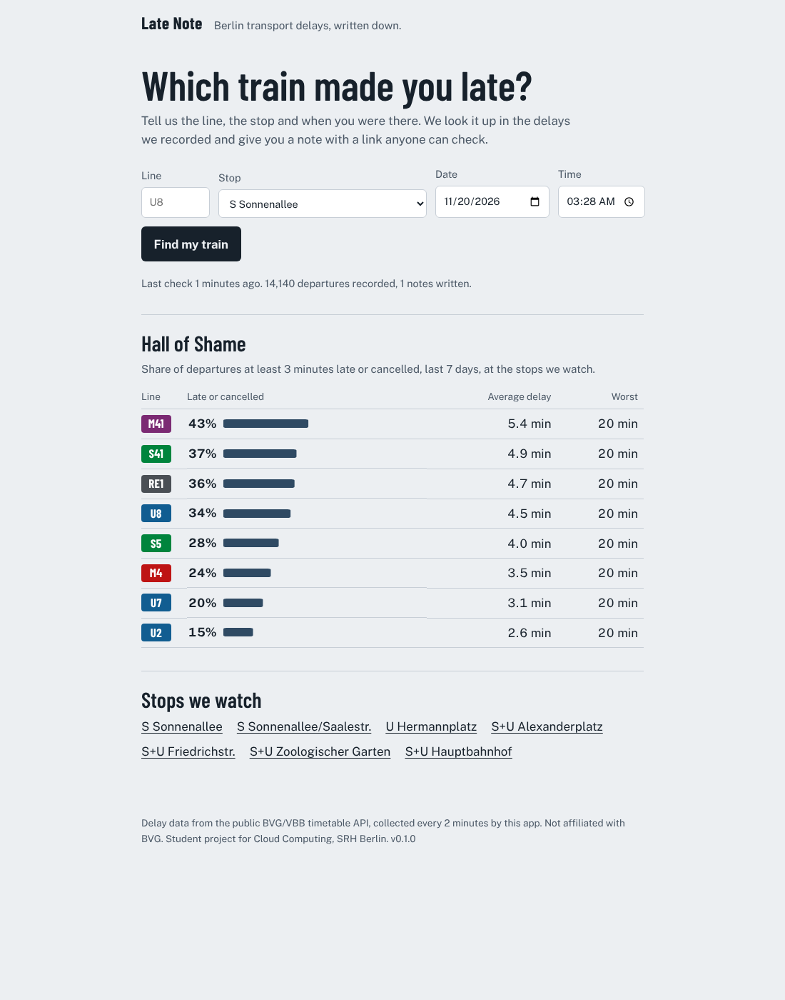
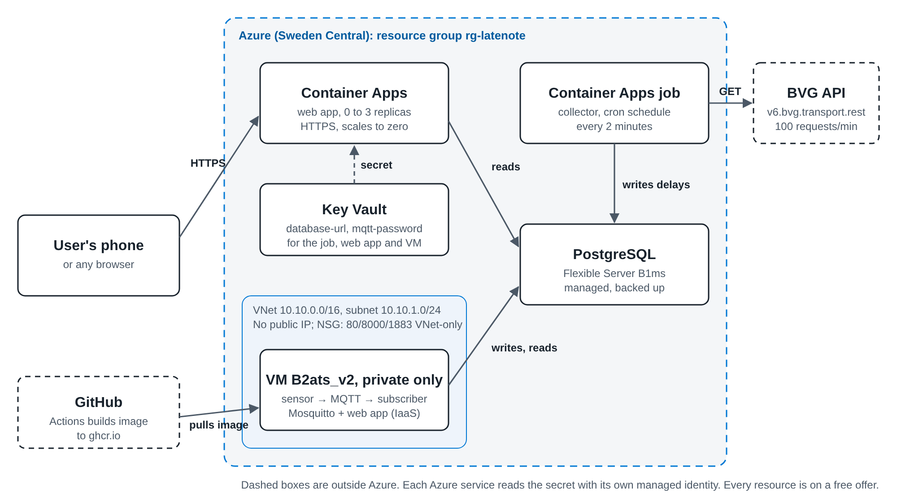

# BVG Late Note

**Real Berlin transport delays, turned into a note you can show.**

"The U8 was 12 minutes late" is easy to say and hard to prove. BVG Late Note
records real departures and delays from the public BVG timetable data every
2 minutes. When you were late, you pick your line, stop and time, and get a
note with a link anyone can check. A Hall of Shame shows which lines were late
most often this week.

Solo project by **Abdul Muhaimin Khan** for Cloud Computing (B.Sc. Computer
Science, SRH Berlin), winter semester 2026.

<p>
  
  
</p>

<sub>Screenshots use local demo data.</sub>

## Architecture



The design follows from one limit: the BVG API allows about **100 requests per
minute**. So users never call BVG. One Azure Function calls it on a timer
(7 stops every 2 minutes, about 3.5 requests per minute) and stores everything
in PostgreSQL. The web app only reads from that database, so 10 or 10,000 users
cause exactly the same load on BVG.

| Component | Service | Why this one |
|---|---|---|
| Collector | Azure Function, timer trigger, Flex Consumption | Runs 30 times an hour for about 2 seconds. Pay per run, not for an idle server. |
| Database | Azure Database for PostgreSQL, Flexible Server B1ms | Managed: patches and backups are Azure's job. SQL makes "share of late trains per line" one query. |
| Web app | FastAPI in a Docker image | One image runs the same on my laptop, the VM, Container Apps and Kubernetes. |
| Hosting | Azure Container Apps | Managed container service: HTTPS, 0 to 3 replicas, no cluster to run or pay for. |
| Virtual machine | Ubuntu VM Standard_B1s in its own VNet with an NSG | The IaaS path for the same image, to compare what I have to manage myself. |
| Secret store | Azure Key Vault + managed identities | The only secret (database URL) never appears in code, images or app settings. |
| Image registry | GitHub Container Registry, built by GitHub Actions | Free, and the workflow uses its own short-lived token. |
| Data source | [BVG/VBB API](https://v6.bvg.transport.rest) | Free, no key, real-time delays per departure. |

## How each building block is covered

| # | Building block | Where it is in this project |
|---|---|---|
| 1 | Problem and model | The collector must run 24/7, users are all over the city, and load is spiky (mornings, strikes). Service models: **PaaS** (Container Apps, managed PostgreSQL), **FaaS** (Function) and **IaaS** (the VM). Deployment model: **public cloud**. |
| 2 | Virtual machine | `infra/01-network-and-vm.sh`: VNet 10.10.0.0/16, subnet 10.10.1.0/24, NSG with SSH only from my IP and HTTP from anywhere; everything else denied. `infra/05-deploy-on-vm.sh` runs the app there. |
| 3 | Containers | `Dockerfile` (non-root, no secrets, health check) and `docker-compose.yml` (web, collector, PostgreSQL). |
| 4 | Storage and networking | Data lives in PostgreSQL, never in a container: a named volume locally, a managed server in Azure. Users reach the app over HTTPS through the Container Apps ingress; the database has no public port locally and only firewall-listed access in Azure. |
| 5 | Orchestration | Azure Container Apps (`infra/04-container-apps.sh`): scaling 0 to 3, rolling updates, health probes. Chosen over AKS because a cluster costs money all month and needs upgrades. The same setup for minikube is in `k8s/` for comparison. |
| 6–7 | Managed and event-driven services | Timer-triggered Azure Function (`function_app/`), managed PostgreSQL, Key Vault. |
| 8 | Security, cost and integration | [docs/security.md](docs/security.md) and [docs/cost.md](docs/cost.md). CI runs the tests on every push. |

## Run it locally

```bash
cp .env.example .env            # set POSTGRES_PASSWORD; .env is never committed
docker compose up --build       # web on http://localhost:8000, collector every 2 minutes
```

Without Docker:

```bash
python -m venv .venv && . .venv/bin/activate
pip install -r requirements-dev.txt
python -m pytest                                   # tests
python -m latenote.collector                       # one collector run (SQLite by default)
uvicorn latenote.main:app --reload                 # http://localhost:8000
```

To try the pages without waiting for real data: `python scripts/seed_demo_data.py`
(local SQLite only; it refuses to touch any other database).

## Deploy to Azure

Needs the Azure CLI (`az login`) and, for the Function, Azure Functions Core Tools.
Run the scripts in order; each one is one building block:

```bash
bash infra/00-resource-group.sh          # asks you to set the budget alert first
bash infra/01-network-and-vm.sh          # VNet, NSG, VM
bash infra/02-database-and-keyvault.sh   # PostgreSQL + Key Vault
bash infra/03-function.sh                # the collector
bash infra/04-container-apps.sh          # the web app (HTTPS)
bash infra/05-deploy-on-vm.sh            # the same image on the VM
bash infra/99-cleanup.sh                 # delete everything
```

The container image is built by GitHub Actions and published to
`ghcr.io/abdulmuhaiminkhan/bvg-late-note`. After the first build, set the
package to public on GitHub (Packages > bvg-late-note > Package settings), so
Azure can pull it without credentials.

## Secrets

No passwords, keys or connection strings in this repository or in any image.
Locally: `.env` (git-ignored). In Azure: Key Vault, read with managed identities.
Details in [docs/security.md](docs/security.md).

## Cost and cleanup

- Budget alert or credit check before creating anything (`infra/00-resource-group.sh` asks).
- Everything lives in resource group `rg-latenote`; `infra/99-cleanup.sh` deletes it.
- About €0 a month on student/free offers at 100 users; about €60–85 at 10,000 users. See [docs/cost.md](docs/cost.md).

## Repository map

```
latenote/        shared Python package: BVG client, database, collector, web app, templates
function_app/    Azure Function wrapper around the collector (timer trigger)
infra/           Azure CLI scripts, one per building block
k8s/             optional Kubernetes manifests (minikube) for comparison
tests/           pytest suite, uses a recorded BVG response
docs/            architecture diagram, cost, security, presentation plan
```

---

## Project log

Solo project: all work by Abdul Muhaimin Khan.

### Sessions 1–2 (4 and 6 Nov): problem, models, first VM
- **Did:** class labs on virtualization and a first cloud VM.
- **Problem:** I could not get a cloud account at first. The Azure for Students form did not list SRH Berlin and kept clearing the school name.

### Session 3 (11 Nov): containers
- **Did:** Docker lab in class. Still looking for a project idea and an account.

### Session 4 (13 Nov): architecture
- **Did:** looked at several ideas (study-room monitor, fridge app, lost and found, office-hours queue).

### Sessions 5–6 (16 and 18 Nov): orchestration, progress check
- **Did:** got Azure for Students through the GitHub Student Developer Pack. Picked **BVG Late Note**: it is original, uses real data every Berliner knows, and has a natural event-driven part (a timer).
- **Why:** I checked the BVG API first: it is free, needs no key, and gives a delay in seconds for every departure. Its limit of 100 requests per minute decided the architecture: collect on a timer, serve users from my own database.

### Session 7 (20 Nov): building the system
- **Built:**
  - the `latenote` package: BVG client, database layer (works on PostgreSQL and SQLite), collector and web pages (find your train, late note, Hall of Shame, stop boards);
  - the Dockerfile and a Compose setup with PostgreSQL on a named volume, tested end to end against PostgreSQL;
  - the Azure Function with a timer trigger;
  - Azure CLI scripts for the VM and firewall, PostgreSQL, Key Vault, the Function and Container Apps;
  - Kubernetes manifests for comparison;
  - CI that runs the test suite and publishes the image to ghcr.io.
- **Decisions:**
  - One image for the web app and the local collector, so local and cloud behave the same.
  - Key Vault and managed identities instead of connection strings in app settings.
  - Container Apps instead of AKS, because it scales to zero and has no cluster cost.
  - Stops near SRH Campus Berlin (S Sonnenallee, Sonnenallee/Saalestr.) plus big hubs.
- **Problem found:** asking the API for one station also returns departures from its sub-stops, with their own IDs. Each departure is now stored by trip, exact stop and planned time.

### Session 8 (23 Nov): security, cost, final check
- **To do:** run the infra scripts, let the collector gather real data, fill in real numbers from the Azure portal in `docs/cost.md`, take the final screenshots.

### Sessions 9–10 (25 / 27 Nov): presentation
- **To do:** rehearse with [docs/presentation.md](docs/presentation.md), record the backup video, present, then run `infra/99-cleanup.sh`.

## Data and licence

Delay data comes from the public BVG/VBB timetable data through
[v6.bvg.transport.rest](https://v6.bvg.transport.rest). This project is not
affiliated with BVG. Code under the MIT licence.
