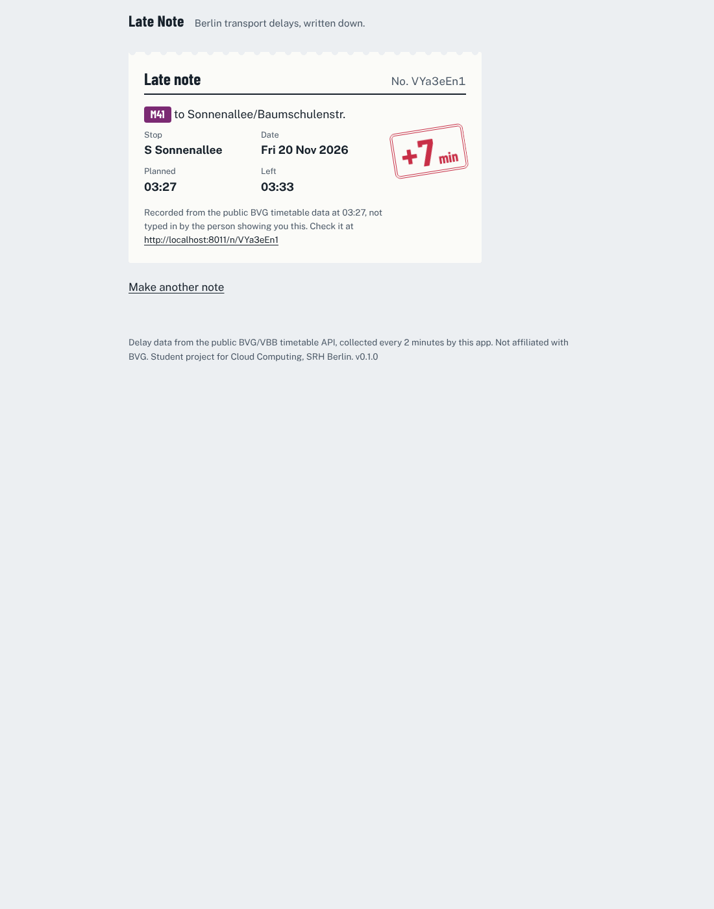

# BVG Late Note

**Real Berlin transport delays, turned into a note you can show.**

"The U8 was 12 minutes late" is easy to say and hard to prove. BVG Late Note
records real departures and delays from the public BVG timetable data every
2 minutes. When you were late, you pick your line, stop and time, and get a
note with a link anyone can check, plus a ready-to-send "sorry, I'm late" message
to copy or share (WhatsApp, email, SMS). A Hall of Shame shows which lines were late
most often this week.

Solo project by **Abdul Muhaimin Khan** for Cloud Computing (B.Sc. Computer
Science, SRH Berlin), winter semester 2026.

<p>
  
  
</p>

<sub>Screenshots use local demo data.</sub>

## Architecture


The design follows from one limit: the BVG API allows about **100 requests per
minute**. So users never call BVG. One scheduled Container Apps job calls it
(7 stops every 2 minutes, about 3.5 requests per minute) and stores everything
in PostgreSQL. The web app only reads from that database, so 10 or 10,000 users
cause exactly the same load on BVG.

The course project is an **IoT-to-cloud pipeline** (sensor → MQTT broker →
cloud processing → storage → dashboard). Here the "sensor" is the BVG
timetable: on the VM, a **virtual sensor** reads the watched stops and publishes
every departure as an MQTT message to a **Mosquitto broker**; a **subscriber**
takes the messages off the broker and stores them in PostgreSQL; the web pages
are the dashboard. The Container Apps job does the same collection without MQTT,
as the serverless path; both write idempotently to the same table, so running
both is safe.

| Component | Service | Why this one |
|---|---|---|
| Collector | Azure Container Apps job, cron schedule `*/2 * * * *` | Runs 30 times an hour for a few seconds. Pay per second of run time (inside the free grant), not for an idle server. |
| Database | Azure Database for PostgreSQL, Flexible Server B1ms | Managed: patches and backups are Azure's job. SQL makes "share of late trains per line" one query. |
| Web app | FastAPI in a Docker image | One image runs the same on my laptop, the VM, Container Apps and Kubernetes. |
| Hosting | Azure Container Apps | Managed container service: HTTPS, 0 to 3 replicas, no cluster to run or pay for. |
| Virtual machine | Ubuntu VM Standard_B2ats_v2 in its own VNet with an NSG, private only (no public IP) | The IaaS path for the same image, to compare what I have to manage myself. Also hosts the MQTT stage. |
| MQTT broker | Eclipse Mosquitto 2 in Docker on the VM, login required, port 1883 open only inside the VNet | The IoT stage: the virtual sensor (`latenote/sensor.py`) publishes to `bvg/departures/<stop_id>` (QoS 1), the subscriber (`latenote/subscriber.py`) writes to PostgreSQL. |
| Secret store | Azure Key Vault + managed identities | The secrets (database URL, MQTT password) never appear in code, images or app settings. |
| Image registry | GitHub Container Registry, built by GitHub Actions | Free, and the workflow uses its own short-lived token. |
| Data source | [BVG/VBB API](https://v6.bvg.transport.rest) | Free, no key, real-time delays per departure. |

## How users reach the system

```
browser ──HTTPS──> ca-latenote.<id>.swedencentral.azurecontainerapps.io (Azure DNS)
        ──> Container Apps ingress (TLS with a managed certificate)
        ──> web container, port 8000
        ──TLS (sslmode=require)──> PostgreSQL on pg-latenote-<suffix>.postgres.database.azure.com:5432

collector job (every 2 min) ──HTTPS──> v6.bvg.transport.rest ;  ──TLS──> PostgreSQL

on the VM:  sensor ──HTTPS──> BVG API
            sensor ──MQTT, login──> mosquitto:1883 (topic bvg/departures/<stop_id>)
            subscriber <──MQTT── mosquitto ;  subscriber ──TLS──> PostgreSQL
```

- Users only ever talk to the Container Apps ingress. There is no other public endpoint.
- The VM is private: VNet 10.10.0.0/16, subnet 10.10.1.0/24, an NSG that allows
  ports 80/8000 only from inside the VNet, and no public IP. It reaches the internet
  (image pull, database) through Azure's default outbound access, and I administer it
  with `az vm run-command` instead of SSH.
- Secrets: every Azure component reads the database URL from Key Vault with its own
  managed identity.

## How each building block is covered

| # | Building block | Where it is in this project |
|---|---|---|
| 1 | Problem and model | The collector must run 24/7, users are all over the city, and load is spiky (mornings, strikes). Service models: **PaaS** (Container Apps, managed PostgreSQL), **serverless / event-driven** (scheduled Container Apps job) and **IaaS** (the VM). Deployment model: **public cloud**. |
| 2 | Virtual machine | `infra/01-network-and-vm.sh`: VNet 10.10.0.0/16, subnet 10.10.1.0/24, NSG that allows only ports 80/8000/1883 from inside the VNet; no public IP, no SSH; everything from the internet denied. `infra/05-deploy-on-vm.sh` runs the app and the MQTT stage there through `az vm run-command`. |
| 3 | Containers | `Dockerfile` (non-root, no secrets, health check) and `docker-compose.yml` (web, collector, PostgreSQL). |
| 4 | Storage and networking | Data lives in PostgreSQL, never in a container: a named volume locally, a managed server in Azure. Users reach the app over HTTPS through the Container Apps ingress; the database has no public port locally and only firewall-listed access in Azure. |
| 5 | Orchestration | Azure Container Apps (`infra/03-container-apps.sh`): scaling 0 to 3, rolling updates, health probes. Chosen over AKS because a cluster costs money all month and needs upgrades. The same setup for minikube is in `k8s/` for comparison. |
| 6 | IoT: devices to the cloud | MQTT: virtual sensor → Mosquitto broker (login, QoS 1, topic `bvg/departures/<stop_id>`) → subscriber, on the VM (`latenote/sensor.py`, `latenote/subscriber.py`, `infra/05-deploy-on-vm.sh`; locally `docker compose --profile mqtt up`). |
| 6–7 | Managed and event-driven services | Scheduled Container Apps job (`infra/04-collector-job.sh`), managed PostgreSQL, Key Vault. `function_app/` has the same collector as an Azure Function: an alternative, not deployed because its storage account is outside the free tier. |
| 8 | Security, cost and integration | [docs/security.md](docs/security.md) and [docs/cost.md](docs/cost.md). CI runs the tests on every push. |

## Run it locally

```bash
cp .env.example .env            # set POSTGRES_PASSWORD; .env is never committed
docker compose up --build       # web on http://localhost:8000, collector every 2 minutes
```

Without Docker:

```bash
python -m venv .venv && . .venv/bin/activate
pip install -r requirements-dev.txt
python -m pytest                                   # tests
python -m latenote.collector                       # one collector run (SQLite by default)
uvicorn latenote.main:app --reload                 # http://localhost:8000
```

The MQTT stage locally (Mosquitto, sensor, subscriber; set `MQTT_PASSWORD` in `.env`):
`docker compose --profile mqtt up --build`.

To try the pages without waiting for real data: `python scripts/seed_demo_data.py`
(local SQLite only; it refuses to touch any other database).

## Deploy to Azure

Needs only the Azure CLI (`az login`). Everything goes to Sweden Central, the allowed
student region that offers the free VM size, and every resource is on a free offer
(see [docs/cost.md](docs/cost.md)).
Run the scripts in order; each one is one building block:

```bash
bash infra/00-resource-group.sh          # asks you to set the budget alert first
bash infra/01-network-and-vm.sh          # VNet, NSG, VM
bash infra/02-database-and-keyvault.sh   # PostgreSQL + Key Vault
bash infra/03-container-apps.sh          # the web app (HTTPS)
bash infra/04-collector-job.sh           # the collector, every 2 minutes
bash infra/05-deploy-on-vm.sh            # the same image + the MQTT stage on the private VM
bash infra/99-cleanup.sh                 # delete everything
```

The container image is built by GitHub Actions and published to
`ghcr.io/abdulmuhaiminkhan/bvg-late-note`. After the first build, set the
package to public on GitHub (Packages > bvg-late-note > Package settings), so
Azure can pull it without credentials.

## Secrets

No passwords, keys or connection strings in this repository or in any image.
Locally: `.env` (git-ignored). In Azure: Key Vault, read with managed identities.
Details in [docs/security.md](docs/security.md).

## Cost and cleanup

- Budget alert or credit check before creating anything (`infra/00-resource-group.sh` asks).
- Everything lives in resource group `rg-latenote`; `infra/99-cleanup.sh` deletes it.
- €0 a month: every resource is on a free offer of Azure for Students. About €60–80 at 10,000 users. See [docs/cost.md](docs/cost.md).

## Repository map

```
latenote/        shared Python package: BVG client, database, collector, MQTT sensor + subscriber, web app
function_app/    alternative: the collector as an Azure Function (not deployed, see above)
infra/           Azure CLI scripts, one per building block
k8s/             Kubernetes manifests (OrbStack or minikube) for comparison
mqtt/            Mosquitto config for the local MQTT stage
tests/           pytest suite, uses a recorded BVG response
docs/            architecture diagram, cost, security, presentation plan
```

---

## Project log

Solo project: all work by Abdul Muhaimin Khan.

### Sessions 1–2 (4 and 6 Nov): problem, models, first VM
- **Did:** class labs on virtualization and a first cloud VM.
- **Problem:** I could not get a cloud account at first. The Azure for Students form did not list SRH Berlin and kept clearing the school name.

### Session 3 (11 Nov): containers
- **Did:** Docker lab in class. Still looking for a project idea and an account.

### Session 4 (13 Nov): architecture
- **Did:** looked at several ideas (study-room monitor, fridge app, lost and found, office-hours queue).

### Sessions 5–6 (16 and 18 Nov): orchestration, progress check
- **Did:** got Azure for Students through the GitHub Student Developer Pack. Picked **BVG Late Note**: it is original, uses real data every Berliner knows, and has a natural event-driven part (a timer).
- **Why:** I checked the BVG API first: it is free, needs no key, and gives a delay in seconds for every departure. Its limit of 100 requests per minute decided the architecture: collect on a timer, serve users from my own database.

### Session 7 (20 Nov): building the system
- **Built:**
  - the `latenote` package: BVG client, database layer (works on PostgreSQL and SQLite), collector and web pages (find your train, late note, Hall of Shame, stop boards);
  - the Dockerfile and a Compose setup with PostgreSQL on a named volume, tested end to end against PostgreSQL;
  - the Azure Function with a timer trigger;
  - Azure CLI scripts for the VM and firewall, PostgreSQL, Key Vault, Container Apps and the collector;
  - Kubernetes manifests for comparison;
  - CI that runs the test suite and publishes the image to ghcr.io.
- **Decisions:**
  - One image for the web app and the local collector, so local and cloud behave the same.
  - Key Vault and managed identities instead of connection strings in app settings.
  - Container Apps instead of AKS, because it scales to zero and has no cluster cost.
  - Stops near SRH Campus Berlin (S Sonnenallee, Sonnenallee/Saalestr.) plus big hubs.
- **Problem found:** asking the API for one station also returns departures from its sub-stops, with their own IDs. Each departure is now stored by trip, exact stop and planned time.

- **Deployed to Azure (20 Nov, night):** all scripts run against my Azure for Students subscription.
  - Requirement: everything on free offers, so the credit lasts to the presentation. That changed the design: the free VM size (B2ats_v2) was only offered to my subscription in **Sweden Central**, so everything runs there; the VM got **no public IP** (not free) and is managed with `az vm run-command`; the collector became a **scheduled Container Apps job**, because a Function needs a storage account outside the free tier; the Container Apps environment has no Log Analytics.
  - Problems fixed on the way: the PostgreSQL resource provider was not registered on the new subscription; newer `az` versions renamed the firewall-rule and database arguments; the new default Container Apps environment type ("Express") does not support Key Vault references; `tr </dev/urandom | head` died with SIGPIPE under `set -o pipefail`.
  - Added the **MQTT stage** from session 6: a virtual sensor publishes each departure to Mosquitto on the VM, a subscriber stores it.
  - CI now builds the image for amd64 and arm64, so it also runs on Apple-silicon laptops.
  - Ran the `k8s/` manifests on a real local Kubernetes cluster (OrbStack): PostgreSQL as a StatefulSet with a volume, 2 web replicas behind a Service, the collector as a CronJob ([screenshot](docs/screenshots/k8s-orbstack-home.png)).

### Session 8 (23 Nov): security, cost, final check
- **To do:** check the numbers in `docs/cost.md` against the portal, take the final screenshots.

### Sessions 9–10 (25 / 27 Nov): presentation
- **To do:** rehearse with [docs/presentation.md](docs/presentation.md), record the backup video, present, then run `infra/99-cleanup.sh`.

## Data and licence

Delay data comes from the public BVG/VBB timetable data through
[v6.bvg.transport.rest](https://v6.bvg.transport.rest). This project is not
affiliated with BVG. Code under the MIT licence.
